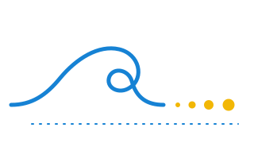

<div align="center">



# marola-ml

<sub>a casa do <b>marola-gpt</b>, um adaptador LoRA sobre o <a href="https://huggingface.co/TucanoBR/Tucano-2b4">Tucano-2b4</a> · <a href="#marola-gpt">o modelo</a> · <a href="#do-corpus-ao-hugging-face">a cadeia</a> · <a href="#licença">licença</a> · <a href="#histórico-do-fork">histórico</a></sub>

[](https://github.com/marola-dev/marola-ml/actions/workflows/ci.yml)
[](https://huggingface.co/TucanoBR/Tucano-2b4)
[](#marola-gpt)
[](https://huggingface.co/h0ffmann/marola-gpt)
[](#licença)
[](#licença)

Onde o [marola](https://github.com/marola-dev/marola) faz o próprio modelo de linguagem pequeno, o
**marola-gpt**: um adaptador LoRA treinado pelo marola no seu corpus de notas sobre o mar e
segurança no mar, aplicado sobre o Tucano-2b4, um modelo aberto treinado do zero em português do
Brasil. É uma distribuição educacional, feita às claras e mantida pelo marola.
</div>

## marola-gpt

Desde a 0.1.0, o marola-gpt é o [Tucano-2b4](https://huggingface.co/TucanoBR/Tucano-2b4)
(2,44 bilhões de parâmetros, Apache-2.0, de Nicholas Kluge Corrêa, Aniket Sen, Sophia Falk e
Shiza Fatimah) com um adaptador LoRA que o marola treina no
[marola-corpus](https://github.com/marola-dev/marola-corpus), na versão fixada em
`corpus.version`. Os pesos do Tucano não mudam: uma release do marola-gpt guarda só o adaptador,
e a base é baixada do repositório do TucanoBR, na revisão que `sea/finetune_tucano.py` fixa
([ADR 0004](docs/adr/0004-marola-gpt-sobre-tucano.md)).

| Release | Corpus | Modelo | Treino | Melhor perda de validação |
|---|---|---|---|---|
| [0.0.1](https://huggingface.co/h0ffmann/marola-gpt/tree/v0.0.1), 15/10/2026 | v0.1.0: 15 080 caracteres | nanoGPT por caractere, treinado do zero: 4 camadas, 4 cabeças, largura 128; 826 240 parâmetros | 1 000 passos numa CPU hospedada do GitHub | 2,4854 no passo 600 |
| uma rodada local, 15/10/2026 (não publicada) | v0.1.0: 5 005 tokens do Tucano | Tucano-2b4 na revisão `b8def49a1931` + LoRA r=8 em `q_proj`/`v_proj`; 1 597 440 parâmetros treináveis | 200 passos em 284 s, numa CPU de 4 núcleos e 16 GB | 3,0201 no passo 75 (a base sozinha: 3,1701) |
| **0.1.0** | v0.1.0 | o mesmo LoRA | `marola-gpt-publish.yml`, tag `marola-gpt-v0.1.0` | ainda não publicada |

O Tucano já escreve português fluente. O que o adaptador acrescenta é pouco, porque o corpus é
pequeno e está em inglês: a perda de validação cai de 3,17 para 3,02 e volta a subir depois do
passo 75, quando o adaptador começa a decorar o corpus. O texto continua sem compromisso com os
fatos. **O marola-gpt não é um assistente, e o texto dele nunca é conselho sobre o mar.**

**Onde ele é distribuído.** No Hugging Face, em `huggingface.co/h0ffmann/marola-gpt`, na conta do
dono por enquanto, público. A partir da 0.1.0, os pesos seguem a Apache-2.0 do Tucano.

### Pergunte a ele

```bash
nix develop
export SEA_PYTHON=/path/to/python                 # com sea/requirements.txt instalado
just marola-gpt-ask "A água-viva"                 # a release mais recente, 120 tokens a mais
just marola-gpt-ask "Correntes de retorno são" --version 0.1.0 --tokens 200 --temperature 0.8 --seed 1
```

O marola-gpt não é um modelo de chat: ele continua o texto que recebe. `just marola-gpt-ask` baixa
a release do Hugging Face na tag dela, confere cada arquivo contra o `CHECKSUMS` da release, baixa
o Tucano-2b4 (cerca de 4,9 GB, só na primeira vez) e roda os dois na CPU. Tudo fica no cache do
próprio Hugging Face (`~/.cache/huggingface`). Precisa de uns 10 GB de RAM. As releases 0.0.x são
do nanoGPT e são recusadas por nome.

## Do corpus ao Hugging Face

A cadeia tem quatro passos: o corpus fixado, o treino do adaptador LoRA sobre o Tucano, o
diretório da release e o upload para `h0ffmann/marola-gpt`. Ela chega ao Hugging Face de dois
jeitos, e **nunca por merge**:

| Jeito | Você roda | O que publica |
|---|---|---|
| [Por tag](#release-por-tag-just-sea-release) (CD) | `just sea-release minor` | o `marola-gpt-publish.yml`, na tag `marola-gpt-vX.Y.Z` enviada |
| [À mão](#release-manual-no-hugging-face) | `just marola-gpt-publish <v> --yes` na sua máquina | o seu próprio `--yes` |

Um upload não tem volta. Os dois jeitos recusam uma release cujos arquivos não batem com os
checksums, e um agente não inicia nenhum dos dois: não cria tag, não dispara workflow, não passa
`--yes`.

### Release por tag: `just sea-release`

O que publica é uma tag `marola-gpt-vX.Y.Z` num commit de main. `just sea-release` cria essa tag:
pega a maior tag `marola-gpt-v*`, incrementa, confere que main está limpo, igual ao origin e com o
CI verde, e então cria e envia a tag. A tag dispara o
[`marola-gpt-publish.yml`](.github/workflows/marola-gpt-publish.yml) num runner hospedado do
GitHub, que treina o adaptador sobre o Tucano a partir do corpus fixado, monta a release e sobe
para `h0ffmann/marola-gpt`, com a tag `vX.Y.Z` lá. Precisa do secret `HF_TOKEN`, um token
fine-grained do Hugging Face com escrita nesse repositório.

```bash
git switch main && git pull
just sea-release minor --dry-run       # todas as checagens e a tag que seria criada; não envia nada
just sea-release minor                 # a primeira release LoRA: marola-gpt-v0.1.0
just sea-release                       # depois, o próximo patch: 0.1.1, 0.1.2, ...
gh run list --workflow marola-gpt-publish.yml --limit 1    # acompanhe a publicação
```

As versões 0.0.x pertencem ao nanoGPT: o script e o workflow recusam uma delas. Uma tag fora de
main é recusada pelo workflow. Merges, quantos forem, não publicam nada até a próxima tag.

### Release manual no Hugging Face

Para montar e subir da sua máquina, logado no Hugging Face como `h0ffmann` (`huggingface-cli
login`, ou `HF_TOKEN` no ambiente). Precisa de Nix, `just` e um Python com
[`sea/requirements.txt`](sea/requirements.txt) instalado, apontado por `SEA_PYTHON`.

```bash
nix develop
export SEA_PYTHON=/path/to/python      # torch (CPU: download.pytorch.org/whl/cpu), transformers, peft, huggingface_hub

just marola-gpt-train                   # 1. o corpus fixado e o adaptador em sea/out-marola-gpt/
just marola-gpt-sample "A água-viva"    #    veja o que ele aprendeu, antes de virar release
just marola-gpt-package 0.1.0           # 2. sea/release/marola-gpt-0.1.0/: adaptador, licença, card, checksums
just marola-gpt-publish 0.1.0           # 3. um dry run: o que iria, e para onde
just marola-gpt-publish 0.1.0 --yes     # 4. o upload para h0ffmann/marola-gpt, com a tag v0.1.0
just marola-gpt 0.1.0                   # os passos 1 a 3 de uma vez, terminando no dry run
```

`just marola-gpt-train --steps 300 --lr 1e-4` muda o treino. Use a mesma versão de uma tag
`marola-gpt-v*` quando a release precisar bater com ela, e rode a partir do checkout dessa tag
para o model card citar o commit certo. O workflow também roda à mão (Actions → "marola-gpt
publish"): é um dry run, a menos que você desmarque `dry_run`.

<details>
<summary>O que roda onde</summary>

| Passo | Arquivo | De quem |
|---|---|---|
| baixar o corpus | `scripts/corpus-fetch.sh` | do marola |
| ler o corpus | [`sea/prepare_corpus.py`](sea/prepare_corpus.py) | do marola |
| treinar o adaptador | [`sea/finetune_tucano.py`](sea/finetune_tucano.py) | do marola |
| a base | [TucanoBR/Tucano-2b4](https://huggingface.co/TucanoBR/Tucano-2b4), revisão `b8def49a1931` | do TucanoBR, Apache-2.0, baixada sem mudança |
| a release | [`sea/package.py`](sea/package.py) | do marola |
| o upload | [`sea/publish_hf.py`](sea/publish_hf.py) | do marola |
| gerar texto | [`sea/ask.py`](sea/ask.py) | do marola |
| o nanoGPT da 0.0.x | [`sea/nanogpt/`](sea/nanogpt/), conferido por [`sea/fork_check.py`](sea/fork_check.py) | de Andrej Karpathy, MIT |

</details>

## O resto do marola-ml

O Python offline por trás do marola, de antes do marola-gpt. Nada disso roda quando o app
responde uma pergunta.

- [`dspy/`](https://github.com/marola-dev/marola-ml/tree/main/dspy): a compilação dos prompts. O
  workflow `compile prompt` roda num modelo do Ollama dentro do job e abre um PR no app com os dois
  arquivos compilados ([como rodar](docs/3-development_prompt-compile.md)).
- [`finetune/`](https://github.com/marola-dev/marola-ml/tree/main/finetune): o caminho antigo, um
  fine-tune do Llama 3.2 (Tier 1, um Modelfile; Tier 2, QLoRA SFT e DPO) que gera o
  `marola-llama3.2` que o app usa hoje. [A página dele](docs/3-development_finetune.md) diz que
  foi substituído para o modelo próprio do marola; uma MIP do umbrella decide o fim dele.
- [`docs/benchmarks/`](https://github.com/marola-dev/marola-ml/blob/main/docs/benchmarks/2026-09-05.md):
  as rodadas de benchmark guardadas. `scripts/benchmark_gate.py` reprova uma rodada nova que fique
  mais de 0,05 abaixo da melhor delas, ou abaixo do prompt simples
  ([o doc do gate](docs/3-development_benchmark-gate.md)).
- `Dockerfile.local`: o Ollama com o `marola-llama3.2` já no store, publicado como
  `ghcr.io/marola-dev/marola-ml:local` quando passa no gate (`docker-local.yml`).
- O caminho do Llama não tem mais workflow de publicação: o `marola-sea-publish.yml` foi trocado
  pelo `marola-gpt-publish.yml` em 14 de outubro de 2026. `just finetune-publish` ainda sobe à
  mão.

```bash
nix develop
just quality            # todos os gates do CI, com o fork check e os self-tests do marola-gpt
just finetune-dataset   # o conjunto de treino do caminho Llama, a partir dos recursos e do corpus fixados
just benchmark          # o --benchmark da imagem do app fixada, no seu Ollama, e depois o gate
```

## Contratos

Releases fixadas, nunca a árvore de outro repositório: a imagem do app (`marola-image`), o tarball
de recursos do app (`resources.version`) e o corpus (`corpus.version`). `just corpus-fetch` e
`just resources-fetch` desempacotam os dois últimos em `.tmp/`. Os prompts compilados voltam para
o app como PR; o marola-gpt vai para o Hugging Face, e a base dele é fixada por revisão em
`sea/finetune_tucano.py`. A tabela completa, com o que fixa cada um, está no
[AGENTS.md](https://github.com/marola-dev/marola-ml/blob/main/AGENTS.md#what-it-consumes-and-produces-mip-0070-54).

## Documentação

- [Design](docs/1-design.md): os três trabalhos, nenhum no caminho de uma requisição, e o mapa
  dos módulos.
- [Bibliotecas](docs/2-libraries.md): cada biblioteca, modelo e ferramenta fixada, e por quê.
- [Desenvolvimento](docs/3-development.md): ambiente, GPU, o runner self-hosted, CI, secrets,
  custo e quem pode rodar o quê, publicação, as versões fixadas.
- [A compilação de prompts](docs/3-development_prompt-compile.md),
  [o fine-tune](docs/3-development_finetune.md),
  [o gate de benchmark](docs/3-development_benchmark-gate.md): cada trabalho e como rodar.
- [Avaliação externa](docs/3-development_external-eval.md): os modelos e benchmarks que o marola
  pede a um avaliador externo, e as condições que todo avaliador segue.
- Decisões: [ADR 0001](docs/adr/0001-marola-sea-from-nanogpt.md), o fork do nanoGPT;
  [ADR 0002](docs/adr/0002-marolagpt-and-the-restricted-licence.md), a cadeia do modelo (a parte da
  licença foi substituída); [ADR 0003](docs/adr/0003-mit-again-and-the-name-marola-gpt.md), MIT de
  novo e o nome marola-gpt; [ADR 0004](docs/adr/0004-marola-gpt-sobre-tucano.md), o marola-gpt
  sobre o Tucano-2b4.
- [Documentação da API](https://docs.marola.dev/5-Repos/marola-ml/api-docs/python/): pdoc de
  `finetune/` e `scripts/`, gerado no branch `api-docs` pelo job `api-docs` do `ci.yml` a cada push
  em main.
- [AGENTS.md](AGENTS.md): as regras para agentes que trabalham aqui.

## Revisão do Gemini

Peça o revisor `marola-dev/gemini` num pull request (barra lateral → Reviewers, ou
`gh pr edit <N> --add-reviewer marola-dev/gemini`). O `marola-gemini-bot` publica uma revisão com
no máximo 10 comentários inline marcados `[high]`/`[medium]`/`[low]` e depois envia um commit com
as correções de que tem certeza, quando `python3 -m compileall -q finetune scripts dspy` passa.
Peça de novo depois de novos commits para uma revisão nova. Ele só roda quando chamado, revisa PRs
de fork sem enviar commits para eles e nunca mexe em `.github/`. O
`.github/workflows/gemini.yml` chama o workflow
[`gemini-review`](https://github.com/marola-dev/marola-devkit/blob/main/docs/4-reference_workflows.md#gemini-review)
do devkit.

## Créditos

- **Nicholas Kluge Corrêa, Aniket Sen, Sophia Falk e Shiza Fatimah**, pelo Tucano (Apache-2.0),
  a base do marola-gpt desde a 0.1.0
  ([doi:10.1016/j.patter.2025.101325](https://doi.org/10.1016/j.patter.2025.101325)).
- **Andrej Karpathy**, pelo nanoGPT (MIT), o código que treinou o marola-gpt 0.0.x.
- **Fabio Akita** ([@akitaonrails](https://github.com/akitaonrails)), cujo
  [microgpt](https://github.com/akitaonrails/microgpt) deu ao marola a ideia de um GPT treinado do
  zero numa máquina só, medido com honestidade. Nenhum código dele está aqui: no dia do fork ele
  não tinha licença ([marola-site#146](https://github.com/marola-dev/marola-site/issues/146)).
- O layout desta página segue o do
  [marola-research](https://github.com/marola-dev/marola-research). O desenho no topo é original,
  feito para este repositório.

## Licença

**O código é MIT** ([`LICENSE`](LICENSE), Copyright (c) 2026 marola.dev): qualquer pessoa pode
usar, mudar e distribuir, mantendo o aviso. O código em `sea/nanogpt/` é de Andrej Karpathy, sob a
própria licença MIT do nanoGPT (`sea/nanogpt/LICENSE`, Copyright (c) 2022 Andrej Karpathy).

**Os pesos do marola-gpt, a partir da 0.1.0, são Apache-2.0**, a licença do Tucano-2b4, de que
eles derivam ([`sea/LICENSE-Tucano-2b4`](sea/LICENSE-Tucano-2b4), copiada byte a byte). Cada
release leva essa licença, dá crédito aos autores do Tucano e diz no model card o que o marola
mudou: só um adaptador LoRA treinado no corpus do marola. A base não é redistribuída. As releases
0.0.x, treinadas do zero, continuam MIT.

O [`REUSE.toml`](REUSE.toml) diz a licença e o titular de cada arquivo, como no
[umbrella](https://github.com/marola-dev/marola) e nos repositórios da
[ouroboric-dev](https://github.com/ouroboric-dev), sem cabeçalho por arquivo; o
[`LICENSES/`](LICENSES) tem os textos, e o CI roda `reuse lint`. Os pesos não entram no
repositório, então o Apache-2.0 fica no `sea/LICENSE-Tucano-2b4` e em cada release.

De 14 de outubro de 2026 até a volta ao MIT
([ADR 0003](docs/adr/0003-mit-again-and-the-name-marola-gpt.md)), o `main` teve uma licença
restrita; nenhuma release saiu sob ela.

## Histórico do fork

A história deste repositório tem quatro partes.

1. **Do marola.** O marola-ml saiu do [umbrella](https://github.com/marola-dev/marola)
   (MIP-0070), com o histórico filtrado para estes arquivos: a compilação de prompts, o gate de
   benchmark e um modelo com fine-tune a partir do Llama 3.2 (`finetune/`).
2. **O fork do nanoGPT, 14 de outubro de 2026.** O código do
   [karpathy/nanoGPT](https://github.com/karpathy/nanoGPT) no commit
   `3adf61e154c3fe3fca428ad6bc3818b27a3b8291` foi copiado sem mudança para `sea/nanogpt/`, sob a
   licença MIT dele (Copyright (c) 2022 Andrej Karpathy, mantido em `sea/nanogpt/LICENSE`). Cada
   arquivo copiado diz isso nas primeiras linhas, e o [`sea/FORK.tsv`](sea/FORK.tsv) registra o
   que cada um era no original. Com ele saiu o marola-gpt 0.0.1.
3. **Do marola de novo, por cima.** No mesmo dia, o modelo ganhou o nome marola-gpt. O
   repositório teve por pouco tempo uma licença restrita e voltou ao MIT antes de qualquer release
   ([ADR 0003](docs/adr/0003-mit-again-and-the-name-marola-gpt.md)).
4. **Sobre o Tucano, 15 de outubro de 2026.** O marola-gpt passou a ser um adaptador LoRA sobre o
   Tucano-2b4 ([ADR 0004](docs/adr/0004-marola-gpt-sobre-tucano.md), #67). O `sea/nanogpt/` fica
   como o código da 0.0.x.
